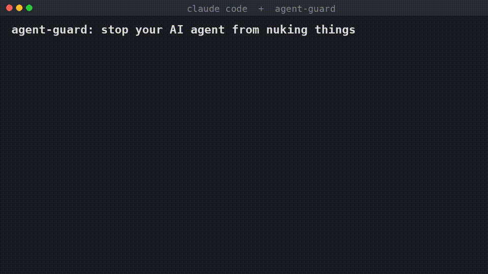

# agent-guard

**Best-effort PreToolUse guard for Claude Code — catch destructive Bash before it runs.**

Claude Code (and similar agent CLIs) can execute shell commands with broad permissions. One bad `rm -rf`, `git reset --hard`, or `DROP DATABASE` can ruin a day. **agent-guard** is a tiny, open-source hook that inspects Bash tool calls and returns `deny` or `ask` when something looks irreversible.

- Single file, **Python 3 stdlib only**
- Official Claude Code PreToolUse JSON I/O
- Optional config allow/deny/ask lists
- Experimental Codex-style exit-code mode

> Author: [rossbuilds](https://github.com/rossbuilds)

---

## Why

Agents are powerful and occasionally reckless. Pattern-based guards are not a sandbox, but they stop the obvious foot-guns: recursive deletes on `/` or `~`, force-pushes, hard resets, SQL drops, `terraform destroy`, cluster deletes, and disk-wiping utilities.

---

## Demo



### Demo plan

1. Install agent-guard into a throwaway `HOME` (or real Claude Code settings).
2. Run `python3 agent_guard.py check 'rm -rf /tmp/demo'` → expect `ask`.
3. Run `python3 agent_guard.py check 'rm -rf /'` → expect `deny`.
4. Run `python3 agent_guard.py check 'echo "rm -rf /"'` → expect `allow` (quoted string).
5. Pipe a PreToolUse JSON payload on stdin and show the `hookSpecificOutput` response.
6. (Optional screen recording) Trigger the same commands from Claude Code and capture the permission prompt / block.

---

## Install

One-liner:

```bash
curl -fsSL https://raw.githubusercontent.com/rossbuilds/agent-guard/v0.1.0/install.sh | bash
```

The installer downloads `agent_guard.py` and verifies it against `SHA256SUMS` from a pinned tag (`AGENT_GUARD_VERSION`, default `v0.1.0`).

Clone-install alternative:

```bash
git clone https://github.com/rossbuilds/agent-guard.git
cd agent-guard
./install.sh
```

This copies `agent_guard.py` to `~/.claude/hooks/agent-guard/` and merges a PreToolUse entry (matcher `Bash`, `python3` + script path) into `~/.claude/settings.json` (backup written first). Safe to re-run (idempotent). Override `HOME` to install into a test prefix:

```bash
HOME=/tmp/ag-test ./install.sh
```

Pin to another release tag:

```bash
AGENT_GUARD_VERSION=v0.1.0 ./install.sh
```

Regenerate local checksums after editing `agent_guard.py`:

```bash
make checksums
```

---

## What's blocked

| Pattern | Default |
|---------|---------|
| `rm -rf` / `rm -r` / `rm -fr` on `/`, `~`, `$HOME`, broad home globs | **deny** |
| Other recursive `rm` (incl. `sudo`, `&&` / `;` / `\|`, `$(...)`) | ask |
| `git push --force` / `-f` | ask |
| `git push --force-with-lease` | ask |
| `git reset --hard` | ask |
| `git clean -fd` | ask |
| `git branch -D` | ask |
| `git push origin +main` | ask |
| `git checkout -- .` / `git restore .` | ask |
| `git stash drop` / `git stash clear` | ask |
| `git filter-branch` / `git filter-repo` | ask |
| `DROP DATABASE` | **deny** |
| `DROP TABLE` / `TRUNCATE` | ask |
| `DELETE FROM …` or `UPDATE … SET …` without `WHERE` (also `psql`/`mysql` `-c`/`-e`) | ask |
| `terraform destroy` | ask |
| `kubectl delete` | ask |
| `helm uninstall` | ask |
| `docker system prune` | ask |
| `docker volume rm` / `docker volume prune` | ask |
| `chmod -R 777 /` | ask |
| `mkfs` | **deny** |
| `dd of=/dev/…` | **deny** |
| `find … -delete` | ask |
| `eval …`, `base64 -d | sh`, destructive `python/perl/node/ruby -c/-e` and heredocs | ask |
| `> file`, `: > file`, `cat /dev/null > file`, risky stdout redirects | ask |
| `mv … /dev/null`, `shred …`, `aws s3 rm --recursive`, `aws s3 rb --force`, `redis-cli FLUSHALL/FLUSHDB` | ask |

Safe examples that should pass: `rm file.txt`, `git push`, `DELETE FROM t WHERE id=1`, `echo "rm -rf /"`.

---

## Config

Merged from:

1. `~/.config/agent-guard/config.json`
2. `<cwd>/.agent-guard.json` (project-local; list keys append)

Keys:

| Key | Meaning |
|-----|---------|
| `allow` | Regex list — **wins**; command is allowed |
| `deny` | Regex list — force `deny` |
| `ask` | Regex list — force `ask` |
| `mode` | `"ask"` or `"deny"` — override default for **non-critical** hits |

See [`examples/config.json`](examples/config.json).

Disable entirely:

```bash
export AGENT_GUARD_DISABLE=1
```

---

## How it works

Claude Code invokes the hook with JSON on stdin, for example:

```json
{
  "tool_name": "Bash",
  "tool_input": { "command": "rm -rf /tmp/cache" },
  "cwd": "/home/you/project"
}
```

On a hit, agent-guard exits `0` and prints:

```json
{
  "hookSpecificOutput": {
    "hookEventName": "PreToolUse",
    "permissionDecision": "ask",
    "permissionDecisionReason": "agent-guard: recursive rm detected: rm -rf /tmp/cache"
  }
}
```

Safe commands produce **no stdout**.

CLI (demo / testing):

```bash
python3 agent_guard.py check 'rm -rf /tmp/x'
python3 agent_guard.py check --codex 'mkfs /dev/sdb'
```

---

## Codex note (experimental)

`--codex` switches to an exit-code protocol used by some Codex CLI hooks and generic wrappers: on a block, print the reason to **stderr** and exit **2**. This path is **experimental** and may need adjustment as Codex hook APIs evolve. The primary, supported target is Claude Code PreToolUse.

---

## Uninstall

```bash
./install.sh --uninstall
# or re-download:
curl -fsSL https://raw.githubusercontent.com/rossbuilds/agent-guard/v0.1.0/install.sh | bash -s -- --uninstall
```

---

## Limitations

**A seatbelt, not a sandbox.** agent-guard is a best-effort safety net, not an isolation boundary.

- Detection is **pattern- and lexer-based** (hand-written bash parsing plus heuristics). Clever quoting, encoding, indirect execution, or tools outside the Bash hook can still bypass it.
- The default install hooks **Bash tool calls only**. It does **not** inspect Claude Code **Write**, **Edit**, or other tools — a model can still overwrite files through those APIs. Use [Claude Code permissions](https://docs.anthropic.com/en/docs/claude-code/settings) and OS-level sandboxing for hard guarantees.
- Quoted strings are treated as inert for many checks, so `echo "rm -rf /"` is allowed by design; do not rely on this hook alone when stakes are high.
- **`--codex` / exit-code mode is experimental** and may change as Codex-style hook APIs evolve. Claude Code PreToolUse JSON is the supported path.

---

## License

MIT — Copyright (c) 2026 rossbuilds
